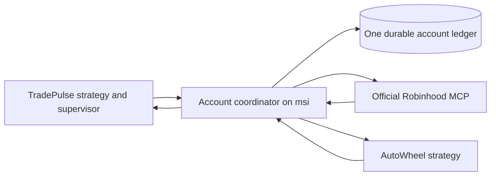

# Shared account design: TradePulse and AutoWheel

Status: implementation specification, with the ledger, restricted adapters and
observation service implemented on 2026-10-05. Live migration remains unqualified;
this document includes requirements that are not yet implemented. See the
current implementation receipt (local evidence omitted from this source repository). The
coexistence audit (local evidence omitted from this source repository) records the earlier independent-writer boundary.

## Decision

Keep both strategy engines and their position-management rules. Add one small Go
**account coordinator** on msi that owns the full-account execution ledger and is
the only path for financial broker writes. Connect the existing broker interfaces
to it. Strategies propose exact orders; the coordinator admits or rejects them,
without inventing signals, resizing orders or moving inventory between strategies.

The initial scope is one account, two registered strategies, one process holding
the account execution lock, one database, and a private local API. There is no
leader election, second execution replica, message bus or distributed lock.
Existing strategy journals remain useful for decisions and lifecycle recovery;
the account ledger alone authorizes ownership, reservations and transport attempts.
Strategy journals do not independently allocate account cash.

The following safety conditions define coexistence:

1. One strategy owns an underlying instrument at a time. Ownership includes
   outstanding orders, stock, options, possible assignment and settlement holds.
2. One account-wide transaction claims ownership and reserves cash/shares before
   broker transport. A strategy cannot allocate the same cash or shares twice.
3. Every write is bound to an account, owner, exact request, durable intent, release
   and current permission. Each placement transport is attempted at most once.
4. Every broker position and working order is accounted for. Verified peer
   inventory is recognized; unexplained inventory remains a blocker.
5. Pause, process failure, stale data or an uncertain write cannot release
   ownership or reserved resources. Only authoritative reconciliation can do so.

## Preserve strategy rules

| Concern | TradePulse | AutoWheel |
| --- | --- | --- |
| Signal generation | Existing stock signals, ranking and approvals | Existing option selection and ranking |
| Local risk rules | Existing lifecycle, issuer and aggregate-risk limits | Three managed symbols, one contract per symbol, fully secured puts and covered calls |
| Management | Existing stops, adds and exits | Existing put-to-assignment-to-call lifecycle and settlement checks |
| Inventory at migration | Own INTC, MU and AAPL and their exact protected lifecycle quantities | No inventory or unresolved submissions |
| Financial writes after migration | Through coordinator's stock interface | Through coordinator's restricted option interface |

Both keep their current entry windows, freshness checks and exact broker review
requirements. Coordination can reject a valid strategy proposal because cash or
an underlying is unavailable. It never converts the proposal to another order.
That admission constraint is visible in the journal and menubar.

No shared lots within one underlying, automatic transfer of ownership, takeover
after a heartbeat timeout, forced sale of peer shares, or option call coverage
using peer shares is allowed in the initial version. Ownership is keyed by the
broker's underlying equity instrument identity, with a checked symbol mapping;
aliases and corporate actions cannot create a second owner by changing a label.
Economic-issuer risk remains subject to each strategy's existing rules. The
account capital limit does not prove combined drawdown or diversification.

## Cash and capital

The design assumption is **one shared pool of actual eligible cash**, a total
$80,000 capital ceiling and no additional reserve, matching the existing cash
authorization. Explicit per-strategy budgets can be specified separately; no
arbitrary split is inferred. Allocation policy is versioned and part of the
activation/configuration binding before live migration.

With a shared pool, available cash is not guaranteed to be sufficient for both
strategies' next signal. The first admitted request can consume it. Separate
budgets are needed if each strategy must retain a guaranteed allocation; a queue
cannot promise that guarantee after money is invested.

The coordinator checks two independent limits for every admission:

- **Cash affordability:** eligible non-margin cash, excluding unsettled/pending
  funds and already reserved cash. A put reserves strike times 100 plus the fee
  allowance; a stock buy reserves its worst permitted debit and fees. TradePulse's
  fractional-market orders have no broker price cap: its existing slippage
  reserve is used for strategy sizing but cannot prove a maximum debit. For this
  order type, hold all potentially spendable account cash against further
  admission until exact terminal fill/debit reconciliation. Reject admission
  unless that cash bound, existing obligations and fees fit the global capital
  ceiling. Previously accepted peer orders remain accounted for and broker
  holds must be reconciled; do not pretend a smaller ledger reservation creates
  a broker price cap. This is temporary account coordination, not a quantity or
  order-type change. A deficit or unexplained debit blocks new risk.
- **Committed capital:** stock acquisition cost plus full short-put liability,
  remaining working-buy/put obligations and unresolved-write obligations, counted
  once. TradePulse's existing stock costs count toward the same $80,000 ceiling.
  Fills move commitments from pending orders into positions atomically. Assignment
  converts put collateral into AutoWheel stock cost without counting both.

Reserve any required fees for credit orders and management actions as well.
Expected option premiums or stock-sale proceeds are not spendable credits before
authoritative settlement. A broker review must substantiate the required fee
allowance; do not omit it because an action reduces principal exposure.

For an uncapped buy, define `D` as the maximum possible total debit, including
fees, proven by the broker's account/order constraints. Admit only if `D` is
finite, `D <= ledger free cash`, `D <= fresh broker eligible cash`, and
`existing capital commitments + D <= $80,000`. Reserve `D` atomically with
ownership; for the uncapped fractional-market case this includes the entire
potentially spendable cash bound. A ledger balance, current quote or 50-basis-point
slippage reserve does not establish `D`. Qualification must cover previously
accepted orders and cash changes while the order can execute. If the available
broker facts cannot establish that bound, reject the request and surface the
missing capability. Proving this bound, or separately authorizing a broker-capped
execution policy, is required before migrating live fractional-market entries.

Hard individual budgets cannot be guaranteed for an uncapped fractional-market
buy when the broker exposes more spendable cash than that owner's budget.
Such a request must be rejected unless its full possible cash debit fits that
budget, or a separately authorized order-policy change provides a broker cap.
Do not silently change TradePulse to whole-share-only entries or describe a
slippage allowance as a hard strategy allocation. The shared-pool default avoids
inventing individual hard budgets; uncapped orders still require the account-wide
cash hold above.

Money is checked integer cents; prices and fractional quantities enter as exact
decimal strings. Round required cash/cost upward. Never round holdings into a
100-share coverage assertion. The TradePulse adapter must prove that conversion
to its existing quantity/price representation loses no required precision.

**Do not calculate capacity by blindly subtracting all ledger holds from broker
buying power.** Broker buying power may already reflect those holds. Use a
persistent cash ledger anchored to an imported, reconciled eligible-cash balance:
new reservations reduce that ledger balance; confirmed debits consume those
reservations; unused amounts and proven settled credits replenish it. The
admissible cash is the lower of fresh broker eligible cash and ledger free cash.
They are alternative bounds, not two amounts to add or two sets of holds to
subtract from one another. Unknown credits do not increase spending authority.
Restart retains the cash ledger; it does not reset it from a transient balance.
Re-anchoring requires a quiescent, fully reconciled account and recorded proof.

For example, from $10,000 free cash, a stock request with a proven $6,000 maximum
debit admitted first leaves at most $4,000 for an $8,000 put request, even if the
broker still reports the old
$10,000 balance. After the broker reflects the hold, it does not become a second
$6,000 deduction. There is no second placement while a transport outcome is
unknown; the original maximum debit and ownership remain reserved.

## Ownership and reconciliation

The coordinator collects complete, account-bound cash, equity positions/orders,
option positions/orders and settlement facts. Collection is timestamped and
generation-bound, validated for completeness and rechecked before a write. These
are a reconciled view of multiple broker reads, not a claim that the broker offers
an atomic account snapshot. Inconsistent rounds block admission.

It classifies each fact as TradePulse-owned, AutoWheel-owned, or unexplained using
exact durable broker order bindings and imported position provenance. Similarity,
matching ticker/quantity, or a caller's claimed owner is not sufficient evidence.

Each engine receives its own exact position/order projection plus common cash,
actual account NAV, reconciliation status and coordinator generation. Peer facts
remain in the complete ledger and account status. They are not quietly discarded
to make reconciliation green. Before new risk, both the projection and full
account must validate. Existing TradePulse NAV-based sizing remains based on the
actual account NAV; no virtual strategy NAV is silently substituted. Peer gains
and losses therefore still affect a shared account's sizing, and historical
standalone results do not establish combined-account performance.

The adapter validates an evidence envelope bound to the account, registered
release/policy, full broker-view digest, owned-projection digest, observation time
and relevant versions. It records that evidence in the existing execution
journal before using the projection. A client's claim that a position belongs to
its peer is not a substitute for coordinator provenance. TradePulse's existing
protocol may remain unchanged only if these checks preserve its verified input
contract; otherwise the protocol migration must be explicit.

An underlying claim is created only on admission, never on a quote scan. It is
released only when reconciled flat with no working orders, unresolved writes,
option exposure or settlement hold. A stopped strategy retains its claim.
Registration expiry revokes permission, not ownership.

AutoWheel's confirmed put fill reserves the underlying through expiry and
assignment. Its existing conservative 24-hour settlement/inventory checks must
pass before the coordinator records exactly 100 AutoWheel-owned available shares.
Those shares alone can secure its call. The coordinator never permits a stock
sale that would remove shares securing a live or possibly accepted call. Call
expiry/call-away uses the same provenance and settlement holds before releasing
shares or ownership. Ambiguous assignment is investigated; it is not supplied
with a fabricated broker assignment receipt.

TradePulse's cancel-stop-then-exit sequence continues to reconcile the exact stop
order and current owned quantity before its exit. A stop filling during the gap
cannot cause an extra sale. Neither client may cancel a peer order. AutoWheel
currently has no cancellation/repricing strategy, so its initial interface grants
no stock-write or cancel capability.

## Small local interface

Expose a bounded JSON API over private Unix sockets. Each connection is associated
with one registered strategy and release; order payloads cannot select an owner.
The local daemons are trusted programs under the existing msi account trust
model, not mutually hostile tenants. Separate Linux users/capabilities are a
different security design if protection against a compromised peer is required.

The minimum operations are:

| Operation | Effect |
| --- | --- |
| `view` / `intent` | Read owned view, whole-account health, or durable outcome for an exact intent |
| `prepare` | Validate exact request, claim underlying, reserve resources and obtain broker review |
| `commit` | Recheck authorization/freshness and attempt that prepared request's transport once |
| `withdraw` | Release a preparation only when the ledger proves transport never began |
| `cancel` | TradePulse only: bind cancellation to its exact known stock order and reconcile once |
| `pause` / `activate` | Persist strategy/account control state and advance its permission epoch |

Use `(account, strategy, intent_key)` as the idempotency key. Bind a canonical
request digest; reuse with different fields is rejected. Generate and persist one
broker-compatible reference before transport. Client reconnects can read the
outcome for that key; they never create a new reference to repair a missing reply.
Keep raw broker review IDs and coordinator preparation tickets distinct.

A snapshot sequence identifies the evidence used; it is not a requirement that
every later read or unrelated preparation retain the same global sequence.
Commit instead verifies the ticket's exact reservation, underlying ownership
version, permission epoch and request digest against a fresh complete view.
Changes to the relevant owned inventory or authorization invalidate it; routine
reads do not. The existing reservation is counted once when checking admission
again, not charged a second time against cash or capital.

The existing interfaces already have review followed by placement, so a small
adapter can map them to `prepare` and `commit`. TradePulse keeps its
`final_authorization` check between those operations. The coordinator also checks
the current registered strategy permission, account pause, generation, release,
owned resources and quote age immediately before transport. A preparation does
not confer standing permission to trade.

Before returning a preparation ticket, persist the validated broker review and
its digest, exact order digest, broker review ID, quote/evidence time and expiry,
ownership/permission versions, and ticket version. Commit rejects a missing,
expired or mismatched durable review. A refresh may supersede a preparation only
while transport is proven not to have started, with the same exact order digest
and a new ticket version that invalidates the old ticket. Never refresh or mutate
a send-started or uncertain request into another attempt.

An expired preparation can be withdrawn only if its durable state proves no
transport attempt. Send-started or uncertain requests cannot expire, release
resources, or be retried. Clients preserve their local uncertain intent until
the coordinator returns an exact conclusive outcome.

An `intent` read reporting `prepared` does not prove that a queued commit cannot
run later. `withdraw` must execute under the same actor fence, verify no transport
started, persist a terminal withdrawn state and invalidate the ticket before
releasing resources. Queued and late commits recheck that durable state and fail.
Retain the idempotency record so a repeated prepare cannot resurrect the withdrawn
intent. Only a conclusive fenced outcome permits the client to clear its local
uncertain intent.

## Durable state and execution

The coordinator holds a lifetime exclusive account process lock. One actor
serializes admission, preparation/commit transitions, cancellations and controls.
Broker operations have bounded timeouts. Database transactions are short; do not
hold an SQL transaction open across a network call. The actor and persisted
reservations retain exclusion while another RPC waits.

Use SQLite owned only by this process, with one writer connection, a local disk,
foreign keys, rollback journal `DELETE` and `synchronous=EXTRA`. Clients read via
the API rather than opening the database, so WAL/checkpoint machinery is not
needed initially. SQLite documents directory synchronization for EXTRA in DELETE
mode and its stronger power-loss durability relative to rollback-mode FULL.
See [SQLite synchronous settings](https://www.sqlite.org/pragma.html#pragma_synchronous)
and [transaction guarantees](https://www.sqlite.org/transactional.html).

Persist account cash/capital state, strategy registrations/permissions, underlying
ownership, exact position facts, intents/reservations and deduplicated events.
Use constraints for one active underlying owner, one strategy intent key and one
bound broker order ID. Keep a database schema version and migration receipts.
This is one account execution database, not a replacement for strategy journals.

Placement follows this sequence:

1. Validate fresh account view, ownership, limits and exact proposed order.
2. Commit claim, full reservation, request digest and broker reference to disk.
3. Obtain and validate broker review; persist its evidence and versioned
   preparation before returning the ticket.
4. On commit, recheck current permission, broker facts, quote age and exact review.
5. Commit `send_started` before making the one broker transport call.
6. Bind the exact receipt and update state, or persist `uncertain` and freeze new
   risk across the account. Lost client responses are resolved by ledger reads.
7. Reconcile subsequent broker fills/terminal states into owner quantities and
   cash/capital movements. Deduplicate cumulative fills; terminal cancellation
   does not erase a partial fill.

A crash after `send_started` but before transport is still ambiguous. Durable
absence of a receipt is never proof that nothing happened. Existing exact-ID
recovery practices remain necessary. Missing broker reference echoes are not
invented; the account-scoped request and exact receipt must bind a confirmed ID.

SQLite durability and a single actor do not make the network call transactional.
The uncertain state and conservative retained reservation cover that gap.

Cancellation uses the same durable intent and write fence. Bind its exact account,
owner, original broker order ID and request digest to a stable cancellation key;
persist `cancel_started` before the one cancellation RPC. Use only reference
fields the broker's cancellation schema actually supports. Repeated client calls
read the original outcome. An uncertain cancellation retains the original order's
obligations and freezes new risk; it cannot trigger another cancel or a presumed
successful replacement/exit. A cancel acknowledgement is not proof of terminal
cancellation. Reconcile the original order to an exact terminal state and preserve
all partial fills before releasing its remaining resources.

## Controls and failure behavior

Keep both menubar apps. Show owned positions, peer ownership exclusions, available
account cash, owned commitments, pending reservations, coordinator health and the
reason an admission was denied. A cash/ownership denial is not a strategy failure.
Do not label a peer position manual or count it as the other strategy's slot.

Each strategy's Live switch controls its new-risk permission while preserving its
documented existing-position management policy. AutoWheel's current off switch
blocks all new option submissions, including new covered calls; preserve that
meaning. TradePulse's pause-new-risk preserves confirmed risk-reducing management.
An account-wide pause blocks all new financial writes and explicitly leaves
already accepted broker orders in place. Existing stops may still execute.
Do not silently redefine either control during migration.

Keep strategy permission, account-wide pause and account reconciliation health
as separate durable fields. TradePulse's existing `pause_new_risk` input cannot
authorize management while the account-wide pause is active. The coordinator
checks the applicable management permission and exact ownership proof even for
an exit; a request labelled risk-reducing receives no automatic bypass.

A pause is acknowledged as applied only after its durable transition completes
under the actor fence. While a bounded broker RPC is already in progress, show the
pause as pending; it cannot retract that accepted or possibly accepted order.
Once acknowledged, subsequent commit/cancel transport checks enforce the new
permission epoch.

Protective stops, confirmed owned exits and their required cancellations have
priority over queued entries. They cannot preempt a transport already in progress.
Among valid new-risk requests, use arrival order; no portfolio optimizer or
automatic displacement of invested peer cash. Long quote/history scans remain
outside the account write queue. Quotes must still be fresh when admitted.

| Failure | Required result |
| --- | --- |
| Peer process/heartbeat stops | Preserve its ownership and positions; revoke its new-risk permission |
| Coordinator unavailable | Neither strategy falls back to direct placement or cancellation; alert immediately; existing broker orders persist |
| Coordinator fails with software stops outstanding | Software protection is unavailable; treat as an urgent protection outage, supervise restart, reconcile first; no unsafe direct-write fallback |
| Broker write outcome unknown | Retain all potentially used resources; block new risk globally; no automatic re-send |
| Unexplained position/order/cash movement | Block new risk; investigate; do not adopt or auto-clear |
| New-risk permission withdrawn | Commit is rejected under the same write fence; known owned risk-reducing actions follow their separate permission |
| Ownership or available shares unproven | Block the affected sale/call/assignment interpretation even if it appears risk-reducing |
| Disk full, failed sync, corrupt/mismatched ledger | No new transport; retain evidence; surface a protection outage if required management cannot run |

The coordinator is a deliberate single dependency. With fractional TradePulse
positions and software stops, its outage can delay exits. The existing supervisor
and broker-native stops mitigate some failures but cannot guarantee fills or
protection during an outage. This limitation must be visible in readiness.

## Changes in the existing code

| Existing seam | Required change |
| --- | --- |
| AutoWheel `internal/wheel.Broker` and `internal/robinhood.Broker` | Add coordinator adapter for owned views, review and submission. Preserve wheel selection and state transitions. Replace peer-file guard only after coordinator readiness proves both clients migrated. |
| AutoWheel `cmd/autowheel/readiness.go`, operator API and native model | Bind activation to coordinator policy/generation/release and display shared-account denials. Preserve current pause semantics. |
| TradePulse `src/pilot/broker.rs` `DirectRobinhoodBroker` / `ExecutionBroker` | Add coordinator execution/owned-view adapter while retaining complete evidence and exact reviewed order checks. |
| TradePulse `src/pilot/reconcile.rs` | Reconcile its owned projection; require complete coordinator reconciliation to admit new risk. Verify peer coverage separately instead of ignoring unknown stocks. |
| TradePulse `src/pilot/runtime.rs` request construction and fill ingestion | Supply shared available cash plus owned holdings/orders; retain actual account NAV, exact lifecycle quantities and broker-ID matching. Record coordinator evidence in host execution journal. |
| TradePulse supervisor/deployment boundary | Register exact release/protocol/risk policy; verify owner view and old lifecycle protection; add guarded coexistence migration and rollback compatibility. |
| Linux services | Add private coordinator state/socket and ordering/readiness dependencies. Financial transport in both old direct adapters must be disabled after cutover. |

Strategy-only market data reads can remain direct initially. The TradePulse
approval watchlist retains its existing ownership and approval rules. Inventory
and financial writes go through the coordinator; no read-only or standalone mode
can become an alternative order writer. A transport audit must cover every stock
place/cancel and option place path, including stop replacement and supervisor
recovery. A new Go dependency/SQLite driver is selected and pinned only when
implementing the coordinator; no dependency is added by this specification.

## Migration without relinquishing TradePulse protection

1. Implement and test the ledger/adapters off production. Finalize cash policy
   and capability registration. Resolve TradePulse's independent storage-capacity
   blocker without deleting recovery evidence.
2. Start the coordinator in observation-only mode. It may read broker facts and
   compare proposed owned views; it has no placement/cancellation permission.
   Record exact TradePulse release, lifecycle, stop/order bindings and account
   evidence. AutoWheel remains blocked.
3. Build a frozen import from fresh broker facts and stopped-consistent journal
   snapshots: register INTC/MU/AAPL with TradePulse, all exact open orders and
   pending obligations, and AutoWheel's empty owned state. Validate quantities,
   costs, cash, options, account and protection. Any uncertainty prevents cutover.
4. Use a supervised quiescence barrier that pauses new risk while preserving
   existing management until the ready replacement can take over. There must
   never be a period with both direct writers and the coordinator live. Record
   import generation and direct-writer disablement before authorizing the new
   route. Reconcile any broker fills during the handoff.
   Prefer a closed-market handoff with TradePulse's existing recovery time buffer
   before the next regular session. Account-wide software protection cannot be
   promised without interruption during process replacement. If the handoff
   cannot preserve the existing supervisor's permitted recovery/protection window,
   do not activate it; restore the verified prior route while peer exposure is
   still flat and before eligible management must resume.
5. Route TradePulse through the coordinator with AutoWheel still disabled. Verify
   identical owned lifecycle/stop policies and targeted execution conformance.
   This is infrastructure evidence, not historical strategy profitability.
6. Bind both new releases and the shared policy in the coordinator's activation
   record. Only now may shared readiness replace AutoWheel's separate-account
   requirement and expose its live switch.

TradePulse's current maintenance/runtime upgrade paths require the same strategy
and protocol. Do not bypass them or relabel changed shared-account semantics a
routine repair. Determine explicitly whether the adapter preserves the verified
protocol contract; if it changes that contract, a supported protocol migration
and new supervisor authorization are required. Preserve candidate and risk-tier
identity unless a separately authorized strategy/risk change is intended.

Before AutoWheel owns anything, rollback may restore the exact prior TradePulse
route only with the coordinator writer disabled and fresh flat-peer/account
reconciliation. After AutoWheel has exposure, rollback must retain shared-account
capability and ledger history. Restoring the old exclusive-account TradePulse
binary would misclassify peer inventory and is no longer a valid rollback.
Never delete owner rows or reservations to obtain a green rollback check.

## Targeted acceptance checks

| Check | Evidence required |
| --- | --- |
| Competing stock/put with proven $6,000/$8,000 debit bounds and $10,000 cash | At most one admitted; held cash is neither reused nor deducted twice |
| Two strategies request the same underlying concurrently | Exactly one owner; rejected peer has no broker write |
| AutoWheel assignment and call-away | Owner retained through missing-contract/settlement period; TradePulse projection remains correct |
| Covered call and peer/duplicate stock sale | Only own 100 available shares secure the call; no sale can remove coverage |
| Crash before/after each durable send transition | Proven unsent preparation can be withdrawn; uncertain send never replayed or released |
| Crash after review, superseded review ticket or late commit after withdrawal | Only a matching durable review can commit; withdrawn or superseded tickets cannot send |
| Client loses coordinator response | Exact intent lookup recovers state; no new broker reference/transport |
| Partial stock fills and cancel-stop race | Owner quantity/cash updated once; filled quantity survives cancel; no over-sale |
| Cancellation response lost or only acknowledged | One cancellation attempt; retain obligations until exact terminal reconciliation; no premature replacement/exit |
| Uncapped fractional-market buy awaiting a fill | A broker-proven full debit bound fits cash and capital; otherwise reject; no competing admission can spend held cash; slippage is never asserted as a price cap |
| Foreign/manual broker activity | Account new risk blocked; no ownership inferred by ticker/quantity similarity |
| Restart, stale data, policy/release mismatch or pause during review | Commit fails safely; no alternate direct writer |
| Coordinator/disk outage with software protection | Alert and supervised recovery; no claim that exits remain available |
| TradePulse import/conformance | Protected quantities, lifecycle stops, source release and risk-tier bindings match exactly |
| Cutover and rollback at each phase | One writer; no lost ownership/reservation; rollback compatible with current peer exposure |

Run only focused checks for changed components. No live financial order is used
to manufacture a passing readiness result. Actual live placement and assignment
still require observation after deliberate operator activation.

## Design review record

Two bounded, read-only Muse Spark 1.3 Contributor reviews completed on the Meta
profile at xhigh reasoning: account cash/durability and TradePulse integration.
The review findings are incorporated above: persist validated review evidence,
fence cancellations and withdrawal, require a broker-proven uncapped-buy debit
bound, preserve full-account health alongside owned projections, and separate
the three control states. Main-agent source inspection checked the existing
broker, execution, reconciliation and migration seams. This validates the design
coverage; it is not evidence of implemented invariants or production conformance.

## Completion condition

Both clients may be live on the bound account only when the coordinator reconciles the
whole account, enforces ownership and cash/capital invariants, all financial write
paths are routed through it, TradePulse's migration/conformance/protection gates
pass, and the operator's cash policy and release-bound activation are explicit.
The current isolation guard stays in force until that condition is met.
